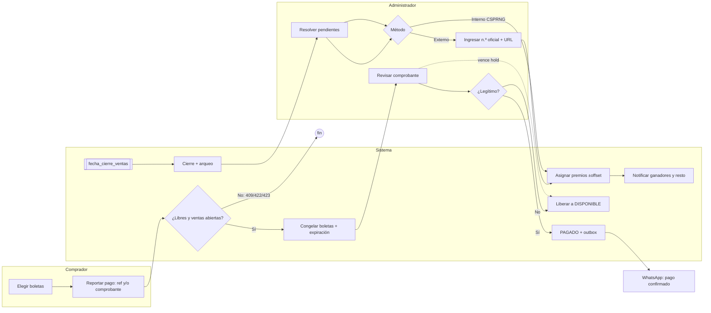

# SGRS: flujo, datos y despliegue

Diagrama BPMN 2.0 editable: [`sgrs-flujo.bpmn`](sgrs-flujo.bpmn) (abrir en bpmn.io o Camunda Modeler; cada tarea lleva en *documentation* los datos que lee/escribe).

## Flujo



## Base de datos y datos por etapa

Una sola base **PostgreSQL 16** (ACID). No se necesita otra para salir a producción: la concurrencia se resuelve con `UPDATE ... WHERE status='DISPONIBLE'` y restricciones únicas, no con Redis.

| Etapa | Tablas | Dato clave |
|---|---|---|
| Crear/publicar | `raffles`, `prizes`, `tickets`, `ticket_numbers` | Parámetros inmutables al pasar a `OPEN`; números `0..total-1` repartidos por boleta |
| Reservar | `payment_transactions`, `transaction_tickets`, `tickets` | `Idempotency-Key`, `external_ref` único mientras esté PENDING/APPROVED |
| Verificar | `payment_transactions`, `notifications` (outbox), `audit_log` | Aprobación y notificación en la misma transacción SQL |
| Expirar/cerrar | `accounting_closures` | Vendidos vs validado vs pendiente + hash del arqueo |
| Sortear | `draws`, `winners`, `tickets`→GANADOR | Método, número ganador, `source_url` si es externo |
| Auditoría | `audit_log` | Hash encadenado, append-only (trigger) |

Estados de boleta: `DISPONIBLE → CONGELADO → PAGADO → GANADOR` (`CONGELADO → DISPONIBLE` por rechazo o vencimiento).

## Contenedores (`docker-compose.yml`)

| Servicio | Imagen | Función |
|---|---|---|
| `db` | postgres:16-alpine (volumen `pgdata`) | Datos; carga `schema.sql` en la primera ejecución |
| `api` | Dockerfile (uvicorn) | Endpoints REST |
| `worker` | misma imagen, `python -m app.worker` | Cada 30 s: expira reservas y cierra rifas vencidas |

```bash
cp .env.example .env   # cambiar secretos
docker compose --env-file .env up --build
```

## Pruebas rápidas

```bash
python -m pytest -q                       # 40 pruebas, incluida concurrencia
SGRS_DSN=postgresql://... python -m scripts.simulate --buyers 40 --seed 7 --method EXTERNAL_LOTTERY
```
E2E con navegador real en viewport móvil (`e2e/e2e.mjs`, requiere `SGRS_DEV_ECHO_OTP=1`, solo pruebas): crea rifa, compra con comprobante, aprueba, cierra, sortea, verifica resultado público, instalabilidad y modo sin conexión.

`scripts/simulate.py` ejecuta un sorteo ficticio completo contra la API real y comprueba invariantes (sin boletas CONGELADO al sortear, recaudo = boletas × precio, cadena de auditoría íntegra).

## Interfaz web (PWA)

JavaScript puro con módulos ES, sin build ni dependencias: la API la sirve desde `public/` (mismo origen, sin CORS). Instalable (manifest + íconos), service worker red-primero para el shell (la API nunca se cachea) y modo oscuro.

| Ruta | Pantalla |
|---|---|
| `#/` | Rifas con progreso y cuenta regresiva |
| `#/login` | OTP en dos pasos |
| `#/r/:id` | Grilla de boletas (5 s de refresco), buscador, filtro, barra de pago fija; resultado público si ya se sorteó |
| `#/pay/:id` | Cuentas de pago con *copiar*, plataforma, n.º de transacción, comprobante (se reduce a ≤1600 px), clave de idempotencia |
| `#/mine` | Mis compras con línea de tiempo y cuenta regresiva de la reserva |
| `#/admin`, `#/admin/new`, `#/admin/r/:id` | Crear/publicar, cola de verificación con visor de comprobante, aprobar/rechazar, cierre y arqueo, sorteo |

Seguridad del cliente: todo texto entra por nodos DOM (nunca `innerHTML`), CSP `default-src 'self'` sin scripts ni estilos en línea, token en `localStorage` (vigencia 8 h, `SGRS_TOKEN_TTL`).

## Compartir y crecimiento

- `GET /r/{id}`: página con etiquetas Open Graph y Twitter Card (los rastreadores de WhatsApp, Facebook, LinkedIn, X y Telegram no ejecutan JavaScript ni leen el `#`) que redirige a `/#/r/{id}`.
- `GET /r/{id}/og.png`: tarjeta 1200×630 generada con título, precio y avance de ventas (fuente DejaVu incluida; no usa nada del sistema).
- El administrador ve su enlace, botón *Copiar* y destinos (WhatsApp, Facebook, LinkedIn, X, Telegram, correo y el menú nativo del teléfono, que cubre Instagram). Cualquier visitante también puede compartir.
- Al pie de la portada: «¿Quieres hacer tu propia rifa?». Quien entra por ahí inicia sesión y llega al formulario; la rifa nueva guarda `referrer_raffle_id` para medir el alcance de cada enlace.

## Notificaciones

WhatsApp Business (Cloud API) con plantillas, cola transaccional, reintentos, recordatorio 24 h antes del sorteo, webhook de estados y baja voluntaria. Detalle y puesta en marcha en [`WHATSAPP.md`](WHATSAPP.md).

## Seguridad implementada

- **Login OTP** (`/auth/otp/request|verify`): código de 6 dígitos (CSPRNG) guardado como HMAC, vigencia 5 min, un solo uso, máx. 5 intentos, reenvío cada 60 s. El teléfono queda verificado y se emite el JWT.
- **Comprobantes** (`PUT /uploads/proof`, `GET /proofs/{id}`): tipo detectado por bytes (PNG, JPEG, WebP, PDF), máx. 5 MB, nombre = SHA-256. Solo los ve quien lo subió, el administrador de la rifa que recibió el pago o un SUPERUSER. Un mismo archivo no respalda dos pagos activos de la misma rifa (`409 DUPLICATE_PROOF`).

## Pendiente antes de producción

1. Probar la integración de WhatsApp contra la API real de Meta (credenciales y plantillas aprobadas; ver `docs/WHATSAPP.md`).
2. Almacenamiento de comprobantes en objeto (S3/GCS, cifrado en reposo): hoy es disco local (`app/storage.py` es la única pieza a reemplazar).
3. Migraciones (Alembic) en lugar de `schema.sql` inicial, TLS en el proxy inverso, backups de PostgreSQL y límite de tasa por IP.
4. Refresh token (hoy el JWT dura 8 h) y cerrar sesión en servidor; notificaciones push/recordatorios.
5. Docker y el job de CI no se ejecutaron en este entorno; solo las pruebas locales.
