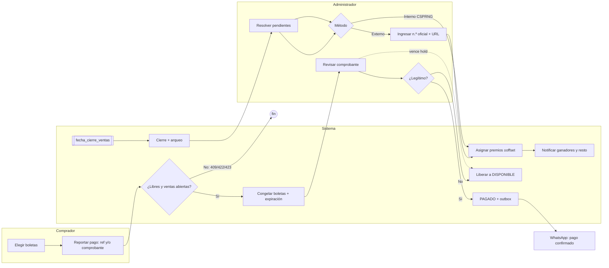

# SGRS: flujo, datos y despliegue

Diagrama BPMN 2.0 editable: [`sgrs-flujo.bpmn`](sgrs-flujo.bpmn) (abrir en bpmn.io o Camunda Modeler; cada tarea lleva en *documentation* los datos que lee/escribe).

## Flujo



## Base de datos y datos por etapa

Una sola base **PostgreSQL 16** (ACID). No se necesita otra para salir a producción: la concurrencia se resuelve con `UPDATE ... WHERE status='DISPONIBLE'` y restricciones únicas, no con Redis.

| Etapa | Tablas | Dato clave |
|---|---|---|
| Crear/publicar | `raffles`, `prizes`, `tickets`, `ticket_numbers` | Parámetros inmutables al pasar a `OPEN`; números `0..total-1` repartidos por boleta |
| Reservar | `payment_transactions`, `transaction_tickets`, `tickets` | `Idempotency-Key`, `external_ref` único mientras esté PENDING/APPROVED |
| Verificar | `payment_transactions`, `notifications` (outbox), `audit_log` | Aprobación y notificación en la misma transacción SQL |
| Expirar/cerrar | `accounting_closures` | Vendidos vs validado vs pendiente + hash del arqueo |
| Sortear | `draws`, `winners`, `tickets`→GANADOR | Método, número ganador, `source_url` si es externo |
| Auditoría | `audit_log` | Hash encadenado, append-only (trigger) |

Estados de boleta: `DISPONIBLE → CONGELADO → PAGADO → GANADOR` (`CONGELADO → DISPONIBLE` por rechazo o vencimiento).

## Contenedores (`docker-compose.yml`)

| Servicio | Imagen | Función |
|---|---|---|
| `db` | postgres:16-alpine (volumen `pgdata`) | Datos; carga `schema.sql` en la primera ejecución |
| `api` | Dockerfile (uvicorn) | Endpoints REST |
| `worker` | misma imagen, `python -m app.worker` | Cada 30 s: expira reservas y cierra rifas vencidas |

```bash
cp .env.example .env   # cambiar secretos
docker compose --env-file .env up --build
```

## Pruebas rápidas

```bash
python -m pytest -q                       # 15 pruebas, incluida concurrencia
SGRS_DSN=postgresql://... python -m scripts.simulate --buyers 40 --seed 7 --method EXTERNAL_LOTTERY
```
`scripts/simulate.py` ejecuta un sorteo ficticio completo contra la API real y comprueba invariantes (sin boletas CONGELADO al sortear, recaudo = boletas × precio, cadena de auditoría íntegra).

## Pendiente antes de producción

1. Login por OTP/SMS (hoy el JWT se emite sin verificación de teléfono).
2. Subida de comprobantes a almacenamiento privado con URL firmada (hoy `proof_url` es texto libre).
3. Envío real de WhatsApp/Twilio desde `notifications` (hoy solo se encolan) y recordatorio de `draw_at`.
4. Migraciones (Alembic) en lugar de `schema.sql` inicial, TLS en el proxy inverso, backups de PostgreSQL y límite de tasa.
5. Frontend PWA.
6. Docker y el job de CI no se ejecutaron en este entorno; solo las pruebas locales.
